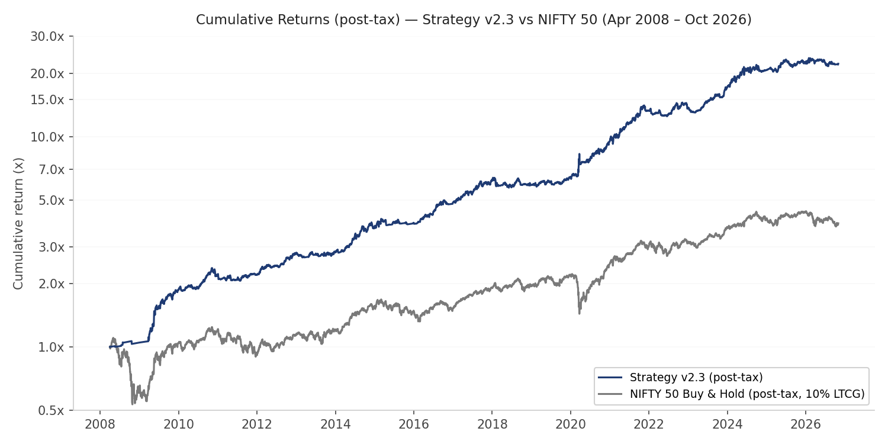
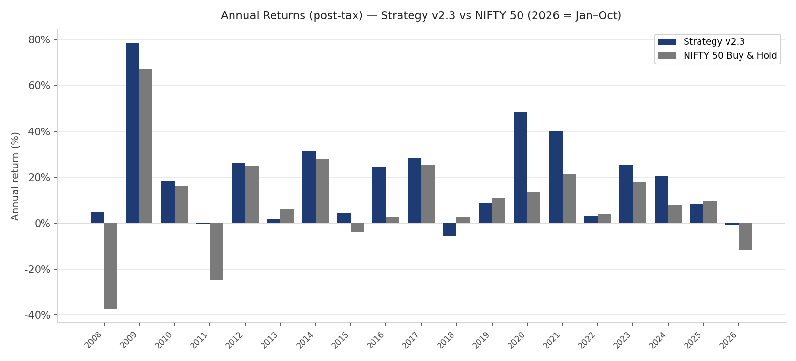
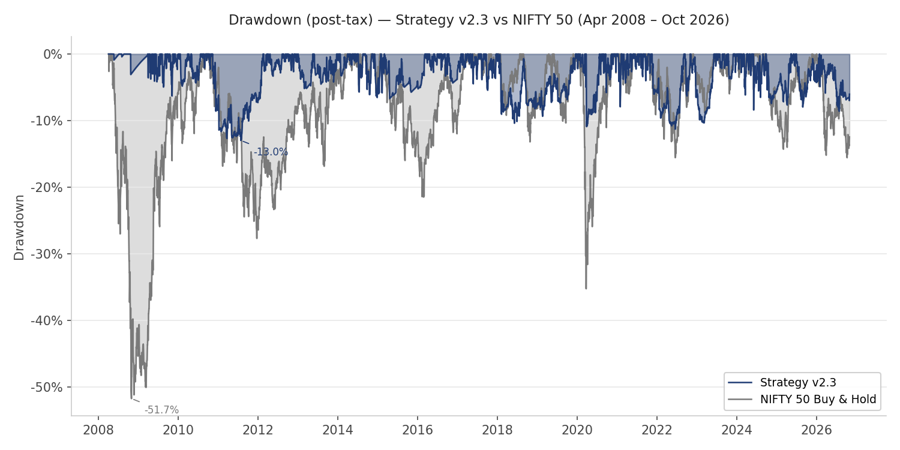

# Indian Equity Macro-Regime Strategy

A rules-based strategy for Indian equities. It holds a momentum-focused stock index when the market is trending up, steps aside into cash (plus a little gold and a basket of defensive stocks) when the market is falling or showing signs of stress, and takes a short position only during rare market panics. The goal is to capture most of the upside of Indian equities while avoiding most of the large losses.

*Research project. All results are backtests (simulations on historical data). The strategy is not deployed and nothing here is investment advice.*

**Current version: v2.3.** Backtest period: 1 April 2008 to 31 October 2026 (2026 is a partial year, January–October).

---

## Contents

1. [Key terms used in this document](#1-key-terms-used-in-this-document)
2. [Headline results](#2-headline-results)
3. [How the strategy works, day to day](#3-how-the-strategy-works-day-to-day)
4. [The components in detail](#4-the-components-in-detail)
5. [Performance by year and in 2026](#5-performance-by-year-and-in-2026)
6. [How the results were checked](#6-how-the-results-were-checked)
7. [Ideas that were tested and rejected](#7-ideas-that-were-tested-and-rejected)
8. [Costs, taxes and trade timing](#8-costs-taxes-and-trade-timing)
9. [Data](#9-data)
10. [Risks and next steps](#10-risks-and-next-steps)
11. [Version history](#11-version-history)
12. [Running the code](#12-running-the-code)

---

## 1. Key terms used in this document

These are explained here once so the rest of the document can be read without guessing. Terms specific to this project are marked *(project term)*.

**Market and instruments**

| Term | Meaning |
|---|---|
| NIFTY 50 | India's main stock index: the 50 largest listed companies on the National Stock Exchange (NSE). Used as the market benchmark and to decide whether the market is trending up or down. |
| NIFTY 200 Momentum 30 ("Momentum 30" or "Mom30") | An NSE index of the 30 stocks from the NIFTY 200 with the strongest recent price momentum (6- and 12-month returns, adjusted for volatility). Rebalanced every June and December. This is what the strategy holds in rising markets. It can be bought through exchange-traded funds (ETFs). |
| ETF | Exchange-traded fund: a fund that tracks an index and trades on the exchange like a share. |
| GOLDBEES | A gold ETF listed on the NSE. Used for the gold position. |
| Liquid fund | A mutual fund that invests in very short-term government and corporate debt. It behaves like a savings account with a slightly higher return. Idle cash is assumed to sit in liquid funds. |
| RBI repo rate | The Reserve Bank of India's policy interest rate. Used as the "risk-free" rate when calculating the Sharpe ratio. |
| NIFTY futures | Contracts that let you profit when NIFTY 50 falls. Used for the rare short positions. |

**Performance measures**

| Term | Meaning |
|---|---|
| CAGR | Compound annual growth rate: the average yearly return, compounded. |
| Max drawdown | The largest fall from a previous peak, in percent. The worst loss an investor would have sat through. |
| Sharpe ratio | Return earned above the risk-free rate (RBI repo), divided by volatility. Higher is better. In this document every Sharpe ratio is calculated this way, including for benchmarks. |
| Volatility | How much returns swing day to day, annualised. |
| Post-tax | After Indian capital gains tax (see [Costs, taxes and trade timing](#8-costs-taxes-and-trade-timing)). All strategy figures are post-tax unless stated otherwise. |
| Buy & hold | Simply owning an index for the whole period, as a comparison. |
| bps | Basis points. 1 bps = 0.01%. |
| pp | Percentage points. Going from 15% to 17% is +2pp. |

**Testing terms**

| Term | Meaning |
|---|---|
| Backtest | Running the rules on past data to see how they would have performed. |
| In-sample period (2008–2016) | The years used to choose settings, for example how many days to wait or how much gold to hold. |
| Held-out period (2017 onward) | Years **not** used when choosing settings. Results here show how the strategy performs on data it was not tuned on. |
| Walk-forward test | A stricter check: for each year, choose settings using only earlier years, then see how that choice did in that year. |
| Point-in-time | Using only information that was actually available on each date. For company accounts this means waiting until the annual report would have been published. |

**Parts of this strategy** *(project terms, each explained fully in [section 4](#4-the-components-in-detail))*

| Term | Meaning |
|---|---|
| Trend filter (or regime filter) | The main on/off switch. "Bull market" = NIFTY 50 closes above its average of the last 100 trading days (its 100-day moving average). "Bear market" = it closes below. |
| Stress signal (called "slow-stress" in the code) | A warning that combines a weakening rupee with rising market fear (India VIX). It moves the strategy to cash even in a bull market. |
| Panic short | A short position on NIFTY 50, taken only during sharp crashes that meet strict conditions. |
| Recovery overlay (called "V2" in the code) | For 60 trading days after a deep bear market ends, hold NIFTY 50 instead of Momentum 30. |
| Flat / flat period | Days when the strategy holds no equity index. A *flat period* is an unbroken run of such days. |
| Defensive quality basket | A small set of financially strong, low-risk stocks that holds part of the money during long flat periods. |
| 40-day waiting rule (called the "persistence gate" in the code) | The defensive basket is only used once a flat period has lasted more than 40 trading days. |
| Idle gold | Part of the idle cash held in gold while gold itself is in an uptrend (added in v2.3). |
| Config 1–7 | The numbered strategy variants built during development, from the simplest (Config 1) to Config 7. **Config 7 is the version 2.1 strategy**: trend filter, Momentum 30, stress signal, panic short, recovery overlay, and a gold rule. The code keeps all seven so earlier results can be reproduced. The current strategy (v2.3) is Config 7 plus the defensive basket, real liquid-fund returns on cash and idle gold. |
| Version numbers (v1.0 … v2.3) | Each version is the strategy as it stood after a set of changes. See [Version history](#11-version-history). |

---

## 2. Headline results

Period: 1 April 2008 – 31 October 2026 (18.6 years; 2026 is January–October only). Strategy figures are after costs and tax.

| | **Strategy v2.3 (current)** | v2.2 | Config 7 (v2.1) | Trend filter only¹ | Momentum 30 buy & hold² | NIFTY 50 buy & hold |
|---|---|---|---|---|---|---|
| **CAGR** | **17.49%** | 16.31% | 15.94% | 14.07% | 13.36% | 7.29% |
| **Sharpe ratio** | **0.87** | 0.80 | 0.77 | 0.70 | 0.42 | 0.13 |
| **Max drawdown** | **-12.97%** | -13.92% | -12.78% | -14.61% | -55.21% | -51.72% |
| Volatility | 12.3% | 12.1% | 12.0% | – | 19.8% | 17.8% |
| ₹1 grows to | ₹22.2 | ₹18.3 | ₹17.2 | – | ₹11.2 | ₹3.9 |

¹ *Trend filter only*: hold Momentum 30 whenever NIFTY 50 is above its 100-day moving average, otherwise sit in a liquid fund. This shows how much the extra components add on top of the simplest version of the idea (about 3.4pp a year).
² Momentum 30 index return, before tax. NIFTY 50 buy & hold is after 10% long-term capital gains tax on profitable years.

**Held-out period, 1 January 2017 – 31 October 2026** (settings were chosen without looking at these years):

| | **v2.3** | v2.2 | Config 7 | Trend filter only | Momentum 30 buy & hold | NIFTY 50 buy & hold |
|---|---|---|---|---|---|---|
| CAGR | **16.11%** | 14.97% | 14.89% | 12.82% | 14.89% | 9.56% |
| Sharpe ratio | **0.80** | 0.73 | 0.73 | 0.64 | 0.54 | 0.32 |
| Max drawdown | -11.28% | -10.88% | -12.78% | -12.81% | -34.21% | -35.23% |

**Key points:**

- **Downside protection.** The worst fall was about 13%, against about 52% for NIFTY 50 and 55% for Momentum 30.
- **Beats the market consistently.** Ahead of NIFTY 50 in 14 of 19 calendar years.
- **Holds up on unseen data.** 16.11% CAGR and a Sharpe ratio of 0.80 over 2017 onward, years not used to choose any settings.
- **Not dependent on a few years.** Even with its five best years removed, the strategy still compounds at about 9.4% a year. NIFTY 50 falls to roughly 0% on the same test.

**What each version added**, measured on the same data and period:

| Step | CAGR | Sharpe | Max drawdown | CAGR from 2017 |
|---|---|---|---|---|
| Config 7 (v2.1) | 15.94% | 0.77 | -12.78% | 14.89% |
| + defensive quality basket (v2.2) | 16.31% | 0.80 | -13.92% | 14.97% |
| + idle cash earns real liquid-fund returns (v2.3) | 16.82% | 0.83 | -13.19% | 15.34% |
| + 25% of idle cash in gold when gold is trending up (v2.3) | **17.49%** | **0.87** | **-12.97%** | **16.11%** |



*Growth of ₹1, after tax, on a logarithmic scale (equal distances mean equal percentage changes). Produced by `make_plots.py`.*

---

## 3. How the strategy works, day to day

Every trading day, after the market closes, the strategy decides what to hold for the next day. It checks these rules in order:

1. **Is the market in a downtrend?** If NIFTY 50 closed below its 100-day moving average, the strategy does not hold equities.
2. **Is there macro stress?** If the stress signal is on (rupee weakening, market fear rising), the strategy does not hold equities, even in an uptrend.
3. **Is there a confirmed panic?** If the panic conditions are all met, the strategy shorts NIFTY 50.
4. **Otherwise it holds Momentum 30.** For 60 days after a deep bear market ends, it holds NIFTY 50 instead.
5. **When it is not holding equities ("flat"):**
   - the money sits in liquid funds
   - 25% of it moves into gold whenever gold is above its 200-day moving average
   - once a flat period has lasted more than 40 trading days, half the money moves into the defensive quality basket (when the basket holds any stocks)

Positions are all-or-nothing: 100% in Momentum 30 (or NIFTY 50), 100% short, or 100% flat. There is no borrowing to invest more than 100%.

**How time and returns were split, April 2008 – October 2026:**

| What the strategy held | Share of days | Share of total growth |
|---|---|---|
| Momentum 30 | 61.2% | 63.2% |
| NIFTY 50 (60 days after deep bear markets) | 2.4% | 14.4% |
| Short NIFTY 50 (panics) | 0.4% | 4.0% |
| Defensive basket + cash | 5.2% | 5.0% |
| Cash, with gold part of the time | 30.8% | 13.4% |

Gold was held, at 25% of idle cash, on 24% of all days. The strategy changed its main position 246 times in 18.6 years, about 13 times a year.

---

## 4. The components in detail

Each part below explains what it does, why it exists, how its settings were chosen, and what testing showed.

### 4.1 Trend filter: NIFTY 50 versus its 100-day moving average

- **What it does.** Long equities only when NIFTY 50 closes above the average of its last 100 daily closes. Below that, the strategy is out of equities.
- **Why.** Long bear markets cause the biggest losses for buy-and-hold investors (2008: NIFTY -52% peak to trough). A trend filter is a simple, well-documented way to sit them out.
- **How chosen.** Windows of 50, 75, 100, 125, 150 and 200 days were tested. 50 days switched in and out too often; 200 days reacted too slowly to crashes. 100 days sits in the stable middle.
- **Design trade-off.** Waiting for the trend to confirm means giving up the first part of sharp rebounds. In return, the strategy avoids being pulled into bear-market rallies that fail (there were six in 2008 alone). Faster re-entry rules were tested and did worse overall (see [section 7](#7-ideas-that-were-tested-and-rejected)).

### 4.2 What to hold in a bull market: NIFTY 200 Momentum 30

- **What.** In bull markets the strategy holds the Momentum 30 index rather than NIFTY 50.
- **Why.** Holding NIFTY 50 in a bull market can only match the market, never beat it. Momentum is one of the most widely documented sources of extra return (Jegadeesh & Titman 1993; Carhart 1997; Asness, Moskowitz & Pedersen 2013), and it fits a strategy that is already built on following trends.
- **How chosen.** Eight Indian indices were considered. Three were fully backtested under the v1.3 rules:

  | Index held in bull markets (v1.3 rules, 2008–2025, before tax) | CAGR | Max drawdown |
  |---|---|---|
  | NIFTY 50 | 12.6% | -16.4% |
  | NIFTY Midcap 150 | 21.3% | -26.1% |
  | **NIFTY 200 Momentum 30** | 18.1% | -18.1% |

  Midcap 150 returned more but lost far more in bad periods, so Momentum 30 was chosen for its better return relative to drawdown.

- **Re-checked under the later rules (v2.1, data to May 2026).** Swapping Momentum 30 for NIFTY 50 cut CAGR from 16.52% to 10.51%. Momentum 30 won in 14 of 18 years. NIFTY 50 won in 2018, 2019, 2022 and 2025, the years when market leadership rotated suddenly between sectors or between large and mid-sized companies.
- **Rotation years.** In those years Momentum 30 is usually still rising, just less than NIFTY 50. Across the full period it added about 6pp a year over NIFTY 50, so the strategy stays with it through rotations. Rules for timing a switch between the two were tested and did not improve results (see [section 7](#7-ideas-that-were-tested-and-rejected)).
- **Replacing the index with our own stock picks was also tested** (five rounds of a self-built momentum basket). None beat the index once realistic trading costs were included (see [section 7](#7-ideas-that-were-tested-and-rejected)).

### 4.3 Stress signal: go to cash when the rupee weakens and fear rises

- **What.** The strategy moves to cash when **all three** of these are true:
  1. the rupee has weakened by more than 1% against the US dollar over 20 trading days
  2. India VIX (a measure of expected market volatility, often called the "fear index") is more than 1.5 standard deviations above its average of the previous 90 days
  3. India VIX has risen over the last 5 days
- **Why.** Emerging-market stress usually shows up as money leaving the country (a weaker rupee) together with rising fear. This catches slower-building stress that the trend filter alone is late on, such as the 2013 "taper tantrum" (when the US Federal Reserve signalled it would slow its bond buying) and the 2018 crisis at the lender IL&FS.
- **5-day cooldown (added in v2.0).** After a stress episode ends, new stress signals are ignored for 5 trading days. In April–May 2019 the signal fired 9 times in short bursts, forcing repeated in-and-out trades that each lost money. Cooldowns of 0, 3, 5, 7, 10, 15 and 20 days were tested. 5 days was best. 7 days or more blocked the second wave of the September 2018 IL&FS crisis.
- **Evidence it is not fitted to India.** The identical rule, with the US dollar index in place of the rupee and the US VIX in place of India VIX, was run on 31 years of US data (1995–2025). It caught all 9 major US stress events while firing on only 3.8% of days (see [section 6](#6-how-the-results-were-checked)).

### 4.4 Panic short: short NIFTY 50 during confirmed crashes

- **What.** The strategy shorts NIFTY 50 only when **all four** of these are true:
  1. India VIX is 25 or higher
  2. VIX has risen more than 50% in 10 days
  3. NIFTY 50 is below its 100-day moving average
  4. NIFTY 50 is more than 15% below its highest close of the last 60 days
  
  It closes the short when NIFTY 50's 5-day average rises back above its 20-day average.
- **How often.** Only 18 days in 18.6 years: 4 days in 2008 and 14 days in March 2020. On those days it earned +13% in total, about 4% of all the strategy's growth.
- **Why the 15% drawdown condition (added in v2.1).** Without it, the short fired into two short-lived dips and lost money as the market bounced: 27 August 2013 (about -23pp on the position) and 24 February 2022, the day Russia invaded Ukraine (about -12pp). Thresholds of 0, 8, 10, 12, 15, 20 and 25% were tested. Anything from 8% to 15% worked about equally well (CAGR within 0.17pp). 20% or more missed two of the four 2008 shorts.
- **Cost of the condition.** It blocked a short on 6 March 2020; the next short on 9 March still caught the COVID crash, but 2020 returned +46% instead of +52%.

### 4.5 Recovery overlay: hold NIFTY 50 for 60 days after a deep bear market

- **What.** When a bear market that fell 15% or more ends, the strategy holds NIFTY 50 instead of Momentum 30 for the next 60 trading days, then switches back.
- **Why.** Right after a crash, a momentum index is still full of the stocks that held up best during the crash, while the rebound is led by the stocks that fell most. Momentum 30 only updates its holdings every six months, so it misses this. This pattern is documented by Daniel & Moskowitz (2016, *Momentum Crashes*). Example: in the 60 days after March 2009, NIFTY 50 rose 56% and Momentum 30 rose 29%.
- **Effect.** Adds about 1pp a year, mostly in 2009 and 2020, with no change to the max drawdown. It is active on about 2% of days, but those days produced 14% of all growth.
- **How chosen.** Drawdown triggers of 10–20% were tested. 15–20% gave identical results; 12% and below fired on ordinary pullbacks. Hold lengths of 30, 45, 60, 90 and 120 days varied CAGR by only 0.43pp. 60 matches the index's six-monthly rebalancing.

### 4.6 Defensive quality basket (added in v2.2)

- **What.** When the strategy has been out of equities for more than 40 trading days in a row, half of the idle money goes into a basket of financially strong, low-risk stocks. The other half stays in cash (and gold, see 4.8). The basket is used only when it actually holds stocks; otherwise the money stays in cash.
- **Why.** Long flat periods earn only cash returns. High-quality, low-risk companies (consumer staples, pharmaceuticals, utilities, IT services) have historically held up better than the market in downturns and can earn more than cash.

**How the stocks are chosen.** The basket is re-picked from scratch every June and December. It does not keep previous holdings unless they qualify again.

1. **Liquid stocks only:** the 200 stocks with the highest average daily traded value over the previous 60 trading days.
2. **Basic financial health**, using the most recent annual accounts that would have been published by then (allowing 6 months after the March financial year-end):
   - operating cash flow above zero
   - net profit above zero
   - debt less than 3 times shareholders' equity
3. **Quality score in the top 40%** of those 200 stocks. The score combines:
   - the **Piotroski F-score**, a set of 9 simple yes/no accounting checks covering profitability, debt and efficiency (only 8 could be computed before 2014 because of gaps in older data)
   - return on capital, revenue growth, debt level, interest cover and how much profit turns into cash
4. **Low risk:**
   - beta of 0.85 or below (the stock moves less than the market)
   - volatility of 30% or below
   - both measured over the previous 250 trading days
5. **Ranking:** a score rewarding higher quality and lower beta and volatility, with a small bonus for traditionally defensive sectors (consumer staples, pharmaceuticals, utilities, IT). Each measure is standardised across the candidates before combining, so no single measure dominates.
6. **Diversification:** at most 5 stocks from any one sector. Sectors come from a hand-maintained list.
7. **Size:** up to 18 stocks, equally weighted.

**How many stocks actually qualify.** Because every filter must be passed, the basket often holds fewer than 18 stocks. It has averaged 11.

| When | Stocks in basket |
|---|---|
| 2008–2009 | 0 (too few companies had usable financial data), so not used |
| June 2010, June 2014 | 2 |
| June 2020 | 1 |
| December 2020 | 0, so not used |
| Most rebalances since 2016 | 11–18 |
| December 2025 | 8 |
| **June 2026 (latest)** | **17:** ITC, Britannia, Hindustan Unilever, Sun Pharma, Hyundai Motor India, ONGC, NTPC, Torrent Pharma, Cipla, Bharti Airtel, Nestlé India, Hindalco, TCS, Infosys, HCL Technologies, Tech Mahindra, Wipro |

**How the settings were chosen.** Six ways of using flat-period money were compared on the same strategy. The figures below are from that comparison (data to May 2026, using the older cash assumption). The last column is return divided by volatility, a simpler measure than the Sharpe ratio used elsewhere.

| Option for money during long flat periods | CAGR | Max drawdown | Return ÷ volatility |
|---|---|---|---|
| Five-condition gold rule (the v2.1 approach) | 16.52% | -12.78% | 1.33 |
| All cash | 16.33% | -12.78% | 1.32 |
| Gold on every stress day, no conditions | 16.02% | -23.21% | 1.23 |
| 100% defensive basket | 17.20% | -17.00% | 1.33 |
| **50% basket + 50% cash (chosen)** | **16.85%** | **-13.92%** | **1.34** |
| 50% basket + 50% gold | 16.71% | -23.08% | 1.27 |

- **The 40-day wait.** Waits of 10, 20, 30, 40, 50 and 60 days were tested on 2008–2016 only. Every basket option picked 40, which was then kept fixed for 2017 onward. The reason for having a wait at all: most flat periods are short blips that reverse quickly, and each trip into and out of the basket costs about 0.30% plus tax. 40 itself is a tested choice, not something derived from theory.
- **The 50/50 split.** 100% basket was compared with 50% basket plus 50% cash. 100% earned slightly more but deepened the max drawdown to -17%, so 50% was chosen for the better balance of return and risk.
- **A more sophisticated version was rejected.** It ranked stocks by how well they had held up in previous bear markets. It did worse, because the stocks that survive one crash are often not the ones that survive the next (2008, 2020 and 2022 had different defensive leaders).
- **Effect in the current strategy.** About +0.4pp a year overall. In the held-out years it made the max drawdown shallower (-10.9% instead of -12.8%). The basket was in use on 254 days.
- **Screen thresholds.** Top 40% quality, beta at most 0.85, volatility at most 30%, 18 stocks and at most 5 per sector are standard defensive-equity screens. The alternative construction above, with a wider beta band (0.6–1.1) and a different ranking, did worse.

### 4.7 Idle cash earns real liquid-fund returns (added in v2.3)

- **What.** On days the strategy is out of equities, idle cash earns the actual daily return of two large liquid funds: Kotak Liquid Fund and Nippon India Liquid Fund, regular plans, so after fund fees.
- **Why.** Earlier versions assumed cash earned the RBI repo rate minus 1%, about 5.4% a year over the period. Real liquid funds earned about 6.7%, so the old assumption understated cash returns. This is a more accurate measurement, not a new source of profit.
- **Effect.** About +0.5pp a year, higher in every year.
- **Fallback.** On any date the fund data does not cover, the code falls back to repo minus 1%.

### 4.8 Idle gold (added in v2.3)

- **What.** On days the strategy is out of equities, 25% of the idle cash is held in GOLDBEES whenever gold's price is above its 200-day moving average. When gold falls below that average, the money returns to the liquid fund.
- **Why.** Gold largely moves independently of Indian stocks and often rises when they fall. It gives the strategy a second source of return in the years it would otherwise sit almost entirely in cash. The two v2.3 changes together (idle gold plus liquid-fund cash) added the most in exactly those years:
  - 2011: about +4pp over v2.2
  - 2019: about +4pp
  - 2025: about +6pp
- **How chosen.**
  - Gold shares of 25%, 50%, 75% and 100%, combined with 50-, 100- and 200-day moving averages, were tested on 2008–2016.
  - A 200-day average was clearly best. In a year-by-year walk-forward test (choosing the setting each year using only earlier years), the 200-day average was picked in every year from 2013 to 2026.
  - Re-choosing the gold share every year did badly: after gold's +72% in 2025 it jumped to 100% gold for 2026 and lost. So the share is fixed.
  - Gold share sensitivity: the Sharpe ratio was essentially flat from 25% to 50% and declined at higher shares, while the max drawdown widened sharply above 50% (to about -20% at 75% and -26% at 100%). 25% sits on the plateau with the shallowest drawdown, so it was chosen.

  Walk-forward results, 2013 to October 2026:

  | | CAGR | Sharpe | Max drawdown |
  |---|---|---|---|
  | v2.2 (no gold, old cash assumption) | 14.70% | 0.71 | -10.88% |
  | Gold share re-chosen every year | 15.58% | 0.66 | -26.14% |
  | Fixed 50% gold, 200-day average | 16.09% | 0.76 | -14.02% |
  | **Fixed 25% gold, 200-day average** | **15.63%** | **0.76** | **-11.28%** |

- **Effect in the current strategy.** About +0.7pp a year, with a slightly lower max drawdown.
- **Cost.** It loses when gold falls: 2015, 2018, 2022, and January 2026, when gold dropped sharply.

### 4.9 Replaced feature: the five-condition gold rule (v1.4–v2.1)

Before v2.2, the strategy moved flat-period money into gold only when five conditions were all met:
1. gold had risen over the last 10 days, but by no more than 10%
2. the rupee had weakened more than 0.5% over 10 days
3. US 10-year bond yields had fallen over 20 days
4. NIFTY 50 was below its 100-day moving average
5. the strategy was in a stress-driven flat period

The code calls this the "G10 gate".

The rule was so strict that it was active on only 27 days in 18 years, so it added very little. It was replaced in v2.2 by the defensive basket. The code is kept and can be switched back on for reproducing older results. The v2.3 idle-gold rule is separate and much simpler.

---

## 5. Performance by year and in 2026

### Year by year

Strategy figures are after tax. NIFTY 50 is after 10% long-term capital gains tax on profitable years. Momentum 30 is the index return before tax. 2008 runs from April; 2026 runs to the end of October.

| Year | **v2.3** | v2.2 | NIFTY 50 | Momentum 30 |
|---|---|---|---|---|
| 2008 | **+4.9%** | +3.8% | -37.5% | -38.5% |
| 2009 | **+78.5%** | +76.5% | +67.0% | +67.2% |
| 2010 | **+18.4%** | +17.9% | +16.2% | +18.4% |
| 2011 | **-0.6%** | -4.5% | -24.6% | -17.3% |
| 2012 | **+26.2%** | +24.8% | +24.7% | +37.1% |
| 2013 | **+2.0%** | +1.8% | +6.2% | +11.6% |
| 2014 | **+31.6%** | +30.8% | +27.9% | +47.9% |
| 2015 | **+4.3%** | +5.0% | -4.1% | +9.9% |
| 2016 | **+24.7%** | +22.9% | +2.8% | +8.5% |
| 2017 | **+28.3%** | +28.5% | +25.5% | +54.5% |
| 2018 | **-5.6%** | -5.1% | +2.9% | -2.4% |
| 2019 | **+8.7%** | +4.9% | +10.8% | +9.7% |
| 2020 | **+48.4%** | +45.8% | +13.8% | +18.8% |
| 2021 | **+39.9%** | +40.2% | +21.6% | +52.1% |
| 2022 | **+3.0%** | +3.6% | +4.0% | -6.4% |
| 2023 | **+25.4%** | +23.7% | +17.9% | +40.7% |
| 2024 | **+20.7%** | +20.8% | +8.0% | +20.0% |
| 2025 | **+8.2%** | +2.2% | +9.5% | -5.1% |
| 2026 (Jan–Oct) | **-0.9%** | -0.1% | -11.8% | -8.3% |



### Crisis periods

| Crisis | Dates | Strategy v2.3 | NIFTY 50 |
|---|---|---|---|
| Global financial crisis | Sep 2008 – Mar 2009 | **+3.3%** | -30.7% |
| European debt crisis | Jul – Dec 2011 | **+5.3%** | -18.1% |
| US "taper tantrum" | May – Sep 2013 | **+0.4%** | -3.3% |
| IL&FS / non-bank lender crisis | Aug – Nov 2018 | **-1.2%** | -4.2% |
| COVID crash | Feb – May 2020 | **+17.8%** | -19.9% |
| Russia–Ukraine war | Feb – Jun 2022 | **-1.5%** | -9.0% |
| March 2026 sell-off | Mar 2026 | **-1.5%** | -11.3% |
| September 2026 sell-off | Sep 2026 | **-2.5%** | -6.1% |



### 2026 so far (January – October)

Settings were fixed before 2026, so this year is a genuine out-of-sample test.

| Month | Strategy v2.3 | NIFTY 50 | Momentum 30 | Days in equities / out | What happened |
|---|---|---|---|---|---|
| Jan | +2.65% | -3.10% | -2.63% | 12 / 10 | Stress signal moved it to cash on 19 Jan; idle gold rose |
| Feb | +0.53% | -0.56% | +3.41% | 9 / 11 | A few short in-and-out trades, then cash from 19 Feb |
| Mar | -1.48% | -11.31% | -13.68% | 0 / 22 | In cash through the crash; idle gold fell |
| Apr | +1.18% | +7.46% | +11.40% | 0 / 22 | Stayed out while NIFTY remained below its 100-day average; defensive basket started 16 Apr |
| May | -0.22% | -1.87% | +1.00% | 0 / 21 | Basket and cash |
| Jun | -2.59% | +1.35% | +1.48% | 4 / 18 | NIFTY moved back and forth around its 100-day average |
| Jul | -1.68% | +2.17% | -1.01% | 22 / 1 | Held Momentum 30, which lagged NIFTY 50 |
| Aug | +2.45% | -1.24% | +2.45% | 21 / 0 | Held Momentum 30, which beat NIFTY 50 |
| Sep | -2.49% | -6.06% | -5.85% | 1 / 21 | Moved to cash on 2 Sep, avoiding most of the fall |
| Oct | +0.87% | +1.91% | -3.23% | 0 / 22 | Cash; basket restarted 28 Oct |
| **Year to date** | **-0.94%** | **-11.77%** | **-8.29%** | | |

**Summary.** The strategy avoided both 2026 sell-offs. With NIFTY 50 down almost 12% and Momentum 30 down 8%, it has held capital roughly flat (-0.9%), about 11pp ahead of NIFTY 50 and 7pp ahead of Momentum 30.

---

## 6. How the results were checked

### Settings chosen on early data, checked on later data

Settings that were tuned (the defensive basket's waiting period and split, and the idle-gold rule) were chosen using 2008–2016 only. They were then judged on 2017 onward. The held-out results in [section 2](#2-headline-results) show performance on data that played no part in choosing settings.

### Walk-forward test of the core settings (run on v2.1)

The three most recently tuned core settings were re-optimised over 13 rolling windows. Each window used 5 years to choose settings and the following year to test them. The three settings were:
- the stress cooldown length
- the panic-short drawdown threshold
- the recovery-overlay drawdown threshold

| Measure (all 13 test years joined together) | Settings re-chosen each window | Fixed production settings |
|---|---|---|
| CAGR | +14.85% | **+15.41%** |
| Sharpe (older fixed 6% risk-free rate) | 0.707 | **0.755** |
| Max drawdown | -15.12% | **-12.78%** |

The fixed settings beat re-optimising every window. The re-chosen settings drifted from window to window, which suggests the optimiser was chasing noise.

### Same rules on US data

The stress signal was run unchanged on US data from 1995 to 2025, with the US dollar index in place of the rupee and the US VIX in place of India VIX. It fired on 3.8% of days and caught all 9 major US stress events:

| Event | Period | Signal |
|---|---|---|
| LTCM hedge-fund collapse | Aug–Oct 1998 | Fired 11 Jun 1998, ~45 days early |
| Dot-com bust | Mar 2000 – Oct 2002 | Multiple episodes |
| Early credit stress | Jul–Aug 2007 | Fired |
| Global financial crisis | Sep 2008 – Mar 2009 | Sustained |
| European debt crisis | Aug–Oct 2011 | Fired |
| China devaluation | Aug 2015 – Feb 2016 | Multiple episodes |
| Fed tightening shock | Oct–Dec 2018 | Fired |
| COVID crash | Feb–Apr 2020 | Fired 21 Feb |
| 2022 inflation shock | Apr–Oct 2022 | Sustained |

In calm years it rarely fired (0% of days in 2017, 1.1% in 2019). A rule that works on a different market without any changes is strong evidence that it is not fitted to Indian data.

### Sensitivity of each setting

| Setting | Value used | Values tested | Result |
|---|---|---|---|
| Trend filter length | 100 days | 50, 75, 100, 125, 150, 200 | 100 in the stable middle |
| Stress cooldown | 5 days | 0, 3, 5, 7, 10, 15, 20 | 0–5 within 0.14pp; 7+ breaks the 2018 defence |
| Panic-short drawdown condition | 15% | 0, 8, 10, 12, 15, 20, 25% | 8–15% within 0.17pp; 20%+ misses 2008 shorts |
| Recovery-overlay trigger | 15% | 10, 12, 15, 18, 20% | 15–20% identical |
| Recovery-overlay length | 60 days | 30, 45, 60, 90, 120 | Within 0.43pp |
| Defensive basket wait | 40 days | 10–60 in steps of 10 | 40 chosen on 2008–2016 |
| Defensive basket split | 50% | 100%, 50% | 50% for lower drawdown |
| Idle gold share and trend window | 25%, 200 days | 25–100%; 50/100/200 days | 200 days chosen every year in walk-forward |
| Cost of trading Momentum 30 | 6 bps | 0–50 bps | Still far ahead of NIFTY 50 at 20 bps |

### Code consistency checks

When the v2.2 and v2.3 features were added, the code was checked to confirm that switching each feature off reproduces the earlier version exactly. The daily returns match to the last decimal place.

---

## 7. Ideas that were tested and rejected

Documented so the same ideas are not retried without a new reason.

**Changing the trend filter**
- *Waiting for confirmation before switching* (a buffer of ±0.5% to ±3% around the 100-day average, or requiring 2–5 days above or below it): fewer switches, but slower exits from real crashes. Sharpe fell to 0.54–0.72 (from 0.79) and max drawdown widened to -18% to -23%.
- *Buffer on re-entry only*: still worse; it misses the start of rallies.
- *Re-entering early after sharp rallies* (re-buying while NIFTY is still below its 100-day average if it has jumped 5–10% in 10–20 days): all 12 versions were worse, because too many bear-market rallies fail (six false starts in 2008 alone).
- *Requiring a rupee or VIX "all clear" before re-entering*: -1.6pp a year, from delayed re-entry into V-shaped recoveries.

**Changing position size**
- *Partial positions when signals disagree* (for example 50% invested): the version chosen on 2008–2016 did worse after 2016. One version looked better only after 2016, so it was not adopted.
- *Sizing positions by volatility*: 32 versions over two rounds, none better. The trend filter already moves to cash when volatility spikes, so this adds nothing.
- *Volatility targeting with borrowing*: looked like +1pp a year until the cost of borrowing (repo + 2%) was charged. It then lost about 1.3pp a year. A no-borrowing version lowered risk but cost about 3pp a year.

**Changing what is held**
- *Own momentum stock picks instead of the Momentum 30 index* (five rounds: plain momentum; with quality filters; realistic costs; excluding pledged and very volatile stocks; tuning the volatility cap): the best version matched the index's held-out Sharpe ratio but had a max drawdown of about -24% against the index's -11%. The losses came from a few individual stocks collapsing. One useful finding: excluding companies with negative cash flow, losses or high debt improved a momentum basket by about 3.7pp a year, though not enough to beat the cheap index.
- *Timing a switch from Momentum 30 to NIFTY 50 in rotation years*: relative-strength switching, swapping during stress, and composition-based signals did not improve results, because each also gave up return in strong Momentum 30 years.
- *Quality as a stand-alone strategy* (buying the highest-quality stocks regardless of momentum): lower and less consistent returns than the momentum approach.

**Changing where idle cash goes**
- *Arbitrage funds*: worse (-0.5 to -1.8pp a year). They dip in sell-offs, exactly when the strategy moves into them, and early-exit loads add cost.
- *Government bond (gilt) funds*: mixed. They helped in 2008 but hurt in 2009, 2013, 2022 and 2026, and deepened the held-out drawdown.

---

## 8. Costs, taxes and trade timing

**Trading costs** (charged every time a position changes):
- Momentum 30 ETF: 6 bps per trade
- NIFTY 50 futures (short side): 3 bps per trade
- Gold ETF: 5 bps per trade
- Defensive basket: 30 bps per trade (brokerage, securities transaction tax, exchange fees, stamp duty, GST and an allowance for price impact), applied to the half of the money that moves
- Liquid fund: no cost

**Taxes**
- The strategy is taxed at 15% on each calendar year's net gain; loss years pay nothing. This approximates India's short-term capital gains tax, which applies because positions are rarely held over a year.
- Defensive basket gains are taxed when the basket is sold, at 15% before 23 July 2024 and 20% after.
- NIFTY 50 buy & hold is taxed at 10% (long-term capital gains) on profitable years.
- **Since 23 July 2024 the actual rates are 20% for short-term and 12.5% for long-term gains.** The model uses the earlier rates throughout. The effect on past results is small (about -0.6pp in 2024 and -0.1pp in 2025); the updated rates will be applied in paper trading.

**When trades happen**
- Each decision uses that day's closing prices, and the backtest assumes the trade happens at that same closing price. The NSE has a post-close session (3:40–4:00 pm) in which shares and ETFs can be bought and sold at the official closing price, so this is achievable for the long positions, the gold ETF and the basket.
- The futures market has no such session. A short has to be placed just before the 3:30 pm close using near-close prices (this affects the 18 short days only).
- Same-day execution matters: a test that delayed every trade by one full day lowered CAGR by about 2pp, which is why trades are placed in the post-close session.
- The USD/INR rate used by the stress signal comes from Yahoo Finance. Aligning it exactly with the Indian 3:30 pm close is part of the paper-trading setup.

---

## 9. Data

**Market data**

| Data | Source | Coverage |
|---|---|---|
| NIFTY 50, USD/INR, India VIX, GOLDBEES, US 10-year bond yield, crude oil | Yahoo Finance, downloaded when the code runs | 2006 – Oct 2026 |
| NIFTY 200 Momentum 30 | NSE index files (niftyindices.com), stored in `data/momentum30_history.csv` | 2008 – 30 Oct 2026 |
| NIFTY Midcap 150, Smallcap 250 | NSE index files | Used by older configurations and research |
| RBI repo rate | RBI monetary-policy announcements, typed into `strategy.py` | 2008 – 2026 |
| Liquid fund daily values (NAVs) | AMFI data via api.mfapi.in, stored in `data/liquid_fund_navs.parquet` | Apr 2006 – Nov 2026 |

India VIX starts in March 2008, which is why the backtest starts on 1 April 2008. The Momentum 30 index was launched by NSE in August 2020. Values before that were calculated by NSE using the same rules applied to past data ("backfilled"), so most of the history is a reconstruction rather than a live index.

**Company and stock data (used for the defensive basket)**

- **Annual accounts.**
  - Sources: about 6,750 annual-report PDFs downloaded from the BSE (Bombay Stock Exchange) and read automatically, covering about 1,560 companies from 2007 onward, merged with exported data from Screener.in.
  - A column-labelling problem in the Screener export was corrected. It raised coverage of operating cash flow from 10% to 93%, and of shareholders' equity from 17% to 96%, for years after 2014.
  - Spot checks found about 94% accuracy for Screener data and about 87% for the automatically read reports.
  - Low-confidence values and extreme outliers are dropped.
  - Banks are excluded, because their accounts are not comparable with other companies.
- **Coverage gaps.** Before 2014, current assets and liabilities and operating profit are often missing. That is why fewer companies can be scored in early years, and why the basket could not be filled in 2008–2009.
- **Liquidity ranking.** NSE's daily trading files ("bhavcopy") are used to rank stocks by average traded value. Since 2024 these files include copies of the previous day on market holidays; these were removed for the June 2026 ranking. They change at most 3 of the 200 names in earlier rankings, which were left as originally built.
- **Stock prices.** Daily adjusted closing prices for about 1,280 NSE stocks, 2007 to 13 November 2026, from Yahoo Finance (`data/yfinance_bulk/adjusted_prices_panel.parquet`, 117 MB, not included in the repository). New data is joined to the old so that there is no artificial price jump where they meet.
- **Point-in-time rule.** A June rebalance uses accounts for the financial year ending about 15 months earlier. A December rebalance uses the year ending 9 months earlier. This avoids using accounts before they would have been published.
- **Delisted companies.** Price and account data include companies that later delisted where the sources keep them. No further survivorship adjustment is made, and coverage leans toward companies that stayed listed.

**Files the strategy reads when it runs**
- `data/defensive_basket_holdings.parquet`: basket stocks at each rebalance
- `data/defensive_basket_daily_returns.parquet`: daily basket return, and whether the basket held stocks that day
- `data/liquid_fund_navs.parquet`: liquid-fund values for idle cash

---

## 10. Risks and next steps

1. **Backtest results.** All figures are simulated. Forward paper trading is the next step.
2. **Sample size.** About 18 years of data, covering 3–4 full boom-and-bust cycles.
3. **Momentum 30 history before August 2020 is reconstructed** from the index rules, because the index has only been live since then.
4. **Market rotation.** When market leadership shifts suddenly between sectors or company sizes, Momentum 30 can trail NIFTY 50 for a period.
5. **Trend-following lag.** As with any trend filter, the strategy re-enters after a rebound has started and cannot anticipate single-day news shocks (for example the September 2019 corporate tax cut).
6. **Flat periods.** In choppy or falling markets the strategy spends long stretches out of equities, so returns in those periods are close to cash returns.
7. **Panic short.** It has fired in two crash episodes (2008 and 2020), and it exits using a simple moving-average rule.
8. **Basket concentration.** In some periods only a few stocks pass the defensive basket's screens, so that half of the idle money is held in fewer names.
9. **Tax rates.** The main model uses the tax rates in force before 23 July 2024. Current rates reduce after-tax returns slightly (see [section 8](#8-costs-taxes-and-trade-timing)).
10. **Data revisions.** Yahoo Finance occasionally revises past prices, which can move results by a few hundredths of a percent. A saved data snapshot is planned.
11. **Capacity.** The effect of trading very large amounts has not yet been studied.

---

## 11. Version history

**Numbers as reported at the time of each version.** Earlier versions were measured on data available then, mostly ending December 2025. Versions before v1.4 are before tax, and versions before v2.2 used a fixed 6% risk-free rate in the Sharpe ratio. For a like-for-like comparison of v2.1, v2.2 and v2.3, see the table in [section 2](#2-headline-results).

| Version | What changed | CAGR | Sharpe | Max drawdown |
|---|---|---|---|---|
| v1.0 | NIFTY 50 trend filter with stress exits and panic short. No gold, no interest on cash. (Before tax.) | 9.91% | 0.33 | -22.2% |
| v1.1.1 | Gold during every stress period; cash earns the repo rate. (Before tax.) | 13.40% | 0.55 | -18.3% |
| v1.2 | Gold only while gold's own momentum is positive; cash earns repo minus 1%. (Before tax.) | 12.59% | 0.50 | -16.4% |
| v1.3 | Momentum 30 replaces NIFTY 50 as the asset held in bull markets. (Before tax.) | 18.08% | 0.83 | -18.1% |
| v1.4 | New stress signal (rupee + VIX); five-condition gold rule; tax added to the model; US validation. | 15.50% | 0.78 | -15.0% |
| v1.5 | Gold only in bear markets (fixed a May 2019 error where gold was bought in a rising market). | 15.64% | 0.79 | -14.7% |
| v2.0 | Recovery overlay (NIFTY 50 for 60 days after deep bear markets) and 5-day stress cooldown. | 16.78% | 0.83 | -13.4% |
| v2.1 (Config 7) | Panic short only if NIFTY 50 is already 15% below its 60-day high. | 16.75% | 0.84 | -12.78% |
| v2.2 | Defensive quality basket replaces the five-condition gold rule. | 16.31%* | 0.80* | -13.92%* |
| **v2.3 (current)** | Idle cash earns real liquid-fund returns; 25% of idle cash in gold when gold is above its 200-day average. | **17.49%*** | **0.87*** | **-12.97%*** |

\* Measured on the current data, April 2008 – October 2026, with the Sharpe ratio based on the RBI repo rate.

---

## 12. Running the code

```bash
git clone https://github.com/Neil-2501/nifty-macro-regime.git
cd nifty-macro-regime
python -m venv venv && source venv/bin/activate
pip install -r requirements.txt
python strategy.py
```

`python strategy.py` downloads the market data from Yahoo Finance and prints a comparison of Configs 1–7, v2.2 and v2.3 (the current strategy) for 1 April 2008 – 31 October 2026, followed by year-by-year returns and crisis periods. It takes about 1–2 minutes.

**Reproducing earlier versions.** The current strategy is the default in `MacroStrategy`. Earlier versions are switched on with these settings:

| To reproduce | Settings |
|---|---|
| v2.2 | `cash_source="repo_haircut", idle_gold_alloc=0` |
| Config 7 (v2.1) | as v2.2, plus `enable_defensive_basket=False` |

**Rebuilding the data files.**

```bash
# Liquid-fund values for idle cash (downloads from api.mfapi.in)
python build_liquid_fund_navs.py

# Defensive basket holdings and returns. Needs the stock-price file
# data/yfinance_bulk/adjusted_prices_panel.parquet (not included; 117 MB).
python build_defensive_basket.py 2026-11-14   # date = end of data, exclusive
```

**Check that the code reproduces the numbers in this README** (v2.3, v2.2 and Config 7, plus checks that each version differs from the previous one only where it should):

```bash
python phase1_verify_identity.py
```

**Regenerate the charts** (also re-checks the headline numbers):

```bash
python make_plots.py
```

**US validation of the stress signal:**

```bash
python validate_us_cross_country.py
```

Research and test scripts for the work described in [section 7](#7-ideas-that-were-tested-and-rejected) are in `experiments/`.

---

## Contact

Neil K. Kapadia · neilkk@umich.edu
